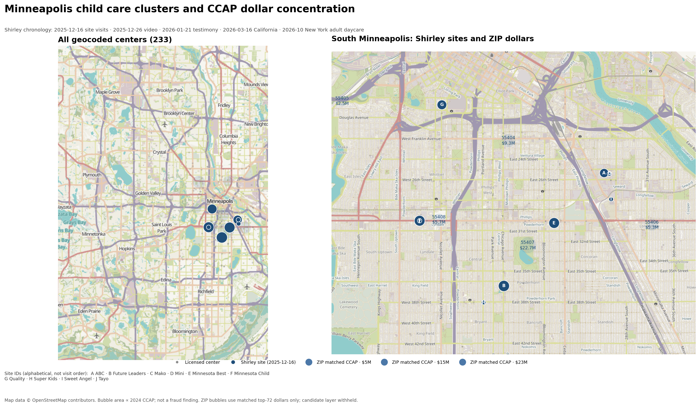

# The Nick Shirley Index

**The one Minnesota daycare that became a federal case was already No. 1 in the public CCAP record.**

A public-record benchmark of the Minnesota child-care claims in the December 2025 video.

**Live page:** https://q3dresearch.github.io/nick-shirley-index/

Status: public showcase and homework ledger. Not a fraud list. Not affiliated with Nick Shirley. Not
legal advice.

## What this is

- An independent reconstruction of the public claims, using public records only.
- A scorecard of what survives, what does not, and what remains unverified.
- A benchmark for per-slot CCAP and ranking performance.
- A homework ledger: what is complete, what is pending, and what is not public.

## What this is not

- It is **not** a list of frauds.
- It is **not** a methodology release.
- It is **not** an accusation against any entity beyond the public record.
- It is **not** a substitute for an audit, a regulator, or a court.

## What we recovered

**The one center that became a federal case was already No. 1 in the public CCAP record.**

Future Leaders received **$3,020,063** in 2024 CCAP — No. 1 among the 71 parsed providers — and was the
largest FY2025 recipient at **$3.68M**. It is the one of Shirley's ten with a federal guilty plea.

| Shirley's claim | Our reconstruction |
|---|---|
| Ten named centers | **10 / 10 recovered** |
| Nine active centers | **9 / 9**; **$17,391,787** FY2025 CCAP |
| Ghost daycares | **not established**; 8 / 9 at a post-video state visit |
| One confirmed case | **1 / 10**: Future Leaders; No. 1 total CCAP |
| Geographic cluster | **10 / 10** in four south Minneapolis ZIPs; **5 / 10** at multi-license addresses |
| $110M fraud | **not reconstructed**; $17.39M FY2025 for the nine active centers |

This is the validation hook: we recovered his entities, his spending, his state-visit outcome, his one
confirmed case, and his geographic cluster. We did not reproduce his $110M total.

## Scorecard

| check | result |
|---|---|
| Centers named or visited in the Minnesota video | **10** |
| Active centers at the time of the state visit | **9** |
| FY2025 CCAP to the nine active centers | **$17,391,787** |
| State visits with children present | **8 of 9**, post-video |
| Centers under further state investigation | **4 of 9**, unnamed |
| Confirmed federal cases among the ten | **1 of 10** |
| The $110M claim | **not reconstructed** from the FY2025 release |
| Mako as a current provider | **contradicted**; closed since 2022 |

The one confirmed case is **Future Leaders Early Learning Center / Fahima Mahamud**: a guilty plea
covering **$4.6M CCAP** and **$854K** in child-nutrition fraud. That is a confirmed case, not a model
result. The other nine are not confirmed by this project.

The state visit is **post-video**. Children present at that visit do not establish pre-video occupancy.
The visit is consistent with both prior operation and post-video adaptation. It cannot distinguish them.

## Benchmark

| benchmark | value | note |
|---|---:|---|
| FY2025 sample median, per licensed slot | **$20,811** | ten named centers |
| FY2025 confirmed anchor, per licensed slot | **$40,889** | 1.96× the sample median |
| FY2025 next cluster | **1.19–1.26×** | next three centers |
| 2024 matched median, per licensed slot | **$15,689** | 38 matched top-72 providers |
| 2024 matched top, per licensed slot | **$37,644** | top of the matched set |
| 2024 matched median, total CCAP | **$1,523,045** | 38 matched top-72 providers |
| 2024 matched top, total CCAP | **$3,020,063** | top of the matched set |

These are different samples and different years. Do not mix them into one ranking.

## Ranking performance

| metric | value |
|---|---:|
| Centers in the frame | **238** |
| Geocoded centers | **233** |
| Top-72 2024 rows parsed | **71** |
| Rows matched to the frame | **38** |
| Ranking AUC | **0.811** |
| Random AUC | **0.500** |
| Recall@50 | **60%** (6/10) |
| Random recall@50 | **21%** |
| Recall@10 | **10%** (1/10) |
| Random recall@10 | **4.2%** |

The ranking is a review queue, not a fraud classifier. A high score is a reason to pull records, not a
finding.

**What recall@10 does not mean.** It does not mean Nick missed nine frauds. It means our top 10 contains
only **one** of his ten featured centers. The other nine are our unverified candidates. The intersection
is one; that is a disagreement, not proof of omission. At k=10, random recall is **4.2%**, so 10% is
about 2.4× random. At k=50, 60% vs 21% is about 2.9× random. The model is a broad screen, not a top-10
oracle.

## Homework

Completed:

- 238-center frame; 233 geocoded;
- ten named centers with FY2025 CCAP and state-visit status;
- top-72 2024 CCAP parsed and matched;
- blind network queue from adverse seeds;
- campaign-finance exact-name check;
- partial property/landlord check;
- DHS and Secretary of State metadata.

Still open:

- full DHS revocation and fine orders;
- official property deeds;
- PPP/SBA loans;
- CCAP 2022–2025 history;
- court dockets;
- fuzzy campaign-finance matching by employer/address/ZIP;
- within-ZIP case-control;
- NYC adult daycare, California hospice/daycare, and Minnesota autism event expansion.

See [`data/homework.csv`](data/homework.csv).

## The map

The public map shows:

- 233 geocoded centers;
- ZIP bubbles scaled by **matched 2024 CCAP dollars**;
- the ten already-public Shirley sites.

Bubble area is proportional to dollars, not to a fraud score. The ZIP bubbles use only the 38 matched
top-72 providers, so they are a **partial** ZIP total, not the full CCAP census.

The working map with entity-level bubbles, candidate names, exact addresses, and the shortlist is held
back until verification or referral. It is not in this repo.

## What is withheld

This repo does not include:

- the sequence of screens;
- the exact predicates, weights, or thresholds;
- independent candidate names or addresses;
- raw records;
- the working map;
- source identities or personal data.

The point of the showcase is to show that the work is real and measurable without handing over the
case file.

## Full report

**DM first. Verification required. No phone calls.**

DM [@nelvOfficial](https://x.com/nelvOfficial) or email **nelv@nelworks.com** with:

1. your name and affiliation;
2. a verifiable institutional or newsroom contact;
3. what you want to verify;
4. why you need entity-level detail;
5. your public key, if you want encrypted delivery.

The full report is for journalists, regulators, auditors, legal-aid or academic researchers, and
affected providers or their representatives. We do not send it to anonymous accounts. We do not take
unscheduled calls or voice notes. See [`CONTACT.md`](CONTACT.md) and [`SAFETY.md`](SAFETY.md).

## Method, limits, and corrections

We publish the aggregate method, sources, limitations, and corrections. The live thresholds,
candidate layer, and working map stay private.

- [Trust and method index](https://github.com/q3dresearch/api-reserve/blob/main/indicator-numbers/forensics/TRUST.md)
- [Methods](https://github.com/q3dresearch/api-reserve/blob/main/indicator-numbers/forensics/METHODS.md)
- [Data sources](https://github.com/q3dresearch/api-reserve/blob/main/indicator-numbers/forensics/DATA-SOURCES.md)
- [Limitations](https://github.com/q3dresearch/api-reserve/blob/main/indicator-numbers/forensics/LIMITATIONS.md)
- [Corrections](https://github.com/q3dresearch/api-reserve/blob/main/indicator-numbers/forensics/CORRECTIONS.md)
- [Naming policy](https://github.com/q3dresearch/api-reserve/blob/main/indicator-numbers/forensics/NAMING.md)
- [Privacy](https://github.com/q3dresearch/api-reserve/blob/main/indicator-numbers/forensics/PRIVACY.md)
- [Governance](https://github.com/q3dresearch/api-reserve/blob/main/indicator-numbers/forensics/GOVERNANCE.md)
- [Open questions](https://github.com/q3dresearch/api-reserve/blob/main/indicator-numbers/forensics/OPEN-QUESTIONS.md)
- [Aggregate reproducibility check](https://github.com/q3dresearch/api-reserve/blob/main/indicator-numbers/forensics/scripts/check_aggregate.py)

California cluster aggregate note: [14545 Friar St, Van Nuys](https://github.com/q3dresearch/api-reserve/blob/main/indicator-numbers/forensics/cases/CA-MERABI-2026.md). No candidate names are published.

## Receipts

- [CBS Minnesota: the guilty plea](https://www.cbsnews.com/minnesota/news/fahima-mahamud-fraud-guilty-plea)
- [CBS Minnesota: state visits, 8 of 9 with children present](https://www.cbsnews.com/minnesota/news/minnesota-child-care-centers-viral-video-operating-expected/)
- [KSTP: DCYF release and “operating as expected”](https://kstp.com/kstp-news/top-news/dcyf-child-care-centers-featured-in-viral-video-operating-as-expected/)
- [Parsed House Oversight Attachment A](https://github.com/q3dresearch/api-reserve/blob/main/indicator-numbers/forensics/data/mn_top_ccap_2024.csv)
- [Minnesota DHS licensing lookup](https://licensinglookup.dhs.state.mn.us/)
- [Minnesota Secretary of State](https://www.sos.state.mn.us/)

Every number is tied to a public record. The method and candidate layer are withheld, not the receipts.

## Sources

Public records only: state licensing and payment releases, the House Oversight Attachment A, DOJ
pleas and charging documents, Secretary of State filings, campaign-finance data, property records, and
public reporting. The map uses OpenStreetMap tiles; the static image carries attribution.

## Corrections

If a number is wrong, open an issue with the source and the arithmetic. Corrections are part of the
product. A benchmark that cannot be corrected is not a benchmark.

## License

Text and charts: CC BY 4.0. Public-record data remains subject to its original terms.
